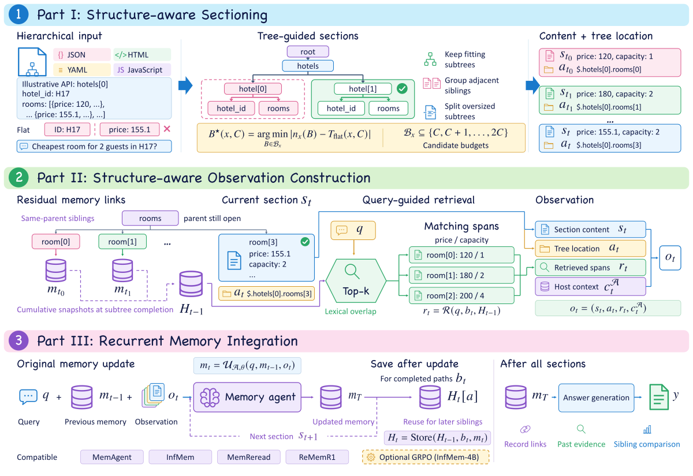

# 🌳 TreeAgent

**Structure-Aware Memory Agent for Processing Long Hierarchical Data**

[](https://arxiv.org/abs/2611.13946)

Code and data examples for the [TreeAgent paper](https://arxiv.org/abs/2611.13946).
TreeAgent is a framework for memory agents processing long hierarchical data.
It uses input structure to guide sectioning and memory retrieval across JSON,
HTML, YAML, and JavaScript.

## 🔍 Overview

TreeAgent groups content into structural sections, attaches structural paths,
and retrieves relevant spans from linked memory states. These inputs are passed
to the host agent's memory update procedure as it processes each section.



See [METHOD_CONTRACT.md](METHOD_CONTRACT.md) for implementation details.

## 🚀 Quick start

Use Python 3.10 or newer and Bash. Install the pinned native parsers if needed:

```bash
git clone https://github.com/ZJU-LLM-Safety/TreeAgent.git
cd TreeAgent

python3 -m pip install -r requirements.txt
bash run_checks.sh
```

Checks run on a CPU with local files. They exercise all four formats, memory
links, retrieval, scoring, sample integrity, and deterministic command outputs.

Inspect a JSON section plan and its incoming memory links:

```bash
PYTHONPATH=code python3 -m treeagent.cli \
  --input examples/toy_document.json \
  --output /tmp/toy_sections.json --section-size 72
```

For HTML, YAML, or JavaScript, select `--format html`, `--format yaml`, or
`--format javascript` and use the corresponding file in `examples/`.
`--method flat` selects consecutive token sections. The CLI uses a character
tokenizer for deterministic inspection. Model integrations supply their model's
tokenizer through the Python API.

## Integrating a memory agent

Model identifiers and generation limits are in
[`configs/agent_settings.json`](configs/agent_settings.json); TreeAgent settings
are in [`configs/www_method.json`](configs/www_method.json). `request_tokens`
limits the prompt and requested output combined. Use it as the serving context
limit and check each host request against it.

Supply the model tokenizer and the agent's update, auxiliary-context, and answer
procedures:

```python
from treeagent import build_sections, parse_json_text, run_memory_agent

# raw_text may contain one JSON value or several complete response documents.
sections = build_sections(parse_json_text(raw_text), tokenizer, 5000, "treeagent")
result = run_memory_agent(
    sections, question, tokenizer,
    update=native_update,           # (question, previous_memory, observation) -> str
    answer=native_answer,           # (question, final_memory) -> answer
    native_context=native_context, # (section, previous_memory) -> context
)
```

`observation` contains the section, structural path, residual spans, and native
context. The loop calls the supplied update for each section, saves its memory,
and passes the final state to the answer procedure. Model serving and the
agent's internal control actions are supplied by these host procedures.

For InfMem, construct the shared retrieval corpus from the original input text:

```python
from treeagent import build_infmem_retrieval_corpus

chunks = build_infmem_retrieval_corpus(raw_text, tokenizer)
retrieval_documents = [chunk.text for chunk in chunks]
```

Use these documents in the host BM25 index for both Flat and TreeAgent. Chunks
contain 500 tokens with 100-token overlap within 5,000-token raw windows.
Use their raw-window indices and token offsets for exclusion rules. Native
retrieval enters `observation.native_context`; structurally linked memory spans
enter `observation.residual`.

## 📂 Data examples

Start with the [example guide](examples/review/README.md). It displays all
62 questions with their mandatory instructions, complete model-input text and
public input fields. Reference answers are linked separately. The exports are
generated from the packaged data.

| File | Contents |
|---|---|
| `data/json/source_examples.jsonl` | 8 API examples spanning eight tasks and seven source groups |
| `data/html/representative.jsonl` | 9 WebSRC examples |
| `data/yaml/real_examples.jsonl`, `data/yaml/native/` | 2 OpenAPI questions with complete supporting YAML documents |
| `data/javascript/representative.jsonl` | 9 static JavaScript examples |
| `data/json/regression_fixtures.jsonl` | 25 source-derived fixtures for task and privacy regression checks |
| `data/yaml/synthetic_fixtures.jsonl` | 9 generated fixtures for YAML task checks |

The package contains 62 JSONL records. Each format's README describes its fields
and usage. Manifests record source attribution and content hashes. JSON API
examples preserve their questions, complete inputs, and answers; `gold_answer`
is for evaluation and must be excluded from model prompts. See `LICENSES.md`
for source licenses and `PRIVACY.md` for the regression-fixture transformations.

The API examples pair complete source responses with revised natural-language
questions and separate mandatory `instructions`. Supply `instructions`, `input`,
and `question` to the model; the question alone is incomplete. Their
`answer_protocol` records the source answer format. For the paper's extracted
answer scoring, use the fields and command in `code/evaluation/README.md`.

For any collection, construct model input through the same export adapter:

```python
from data_construction.review_examples import public_input, render_prompt

public = public_input(row, context_format="yaml")  # json/html/yaml/javascript
complete_input = render_prompt(public)
agent_question = public["instructions"] + "\n\nQuestion\n" + public["question"]
# Feed public["input"] through the native host's sectioning/memory loop.
```

Each sample's evaluation fields specify its matching rule. See
`code/evaluation/README.md` for scoring and `manifests/sample_revisions.json`
for sample revisions.

## Validation

```bash
bash run_checks.sh
python3 scripts/check_formats.py --all-records
python3 scripts/check_artifact.py
```

The format check plans all 62 records, including the complete multi-document API
inputs. Add `--tokenizer /path/to/local/tokenizer` to use a locally installed
model tokenizer. See [VALIDATION.md](VALIDATION.md) for the check suite.

## 📄 Citation

If you use TreeAgent in your research, please cite:

```bibtex
@misc{gu2026treeagent,
  title={{TreeAgent}: Structure-Aware Memory Agent for Processing Long Hierarchical Data},
  author={Wei Gu and Weiwei Qi and Jiajun Tang and Tianhang Zheng and Bo Chen and Zhibo Zhang and Jinfei Liu and Kui Ren},
  year={2026},
  eprint={2611.13946},
  archivePrefix={arXiv},
  primaryClass={cs.AI},
  url={https://arxiv.org/abs/2611.13946}
}
```
